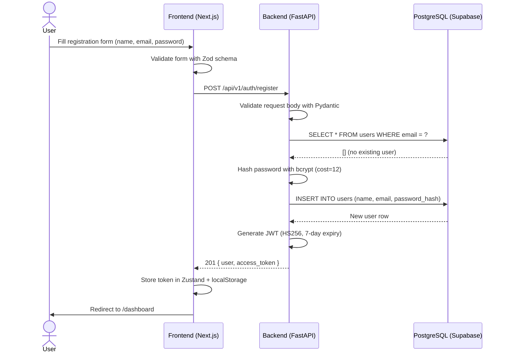
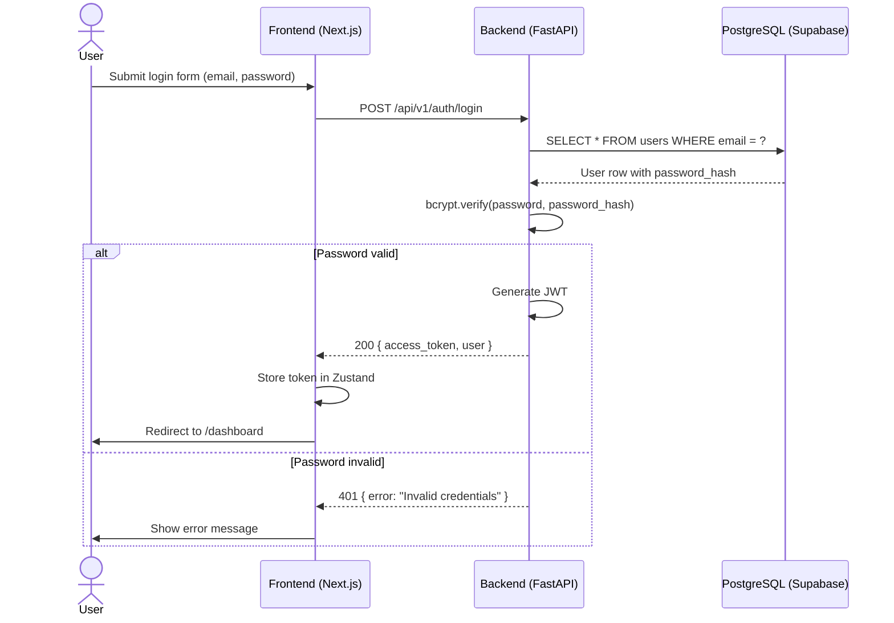
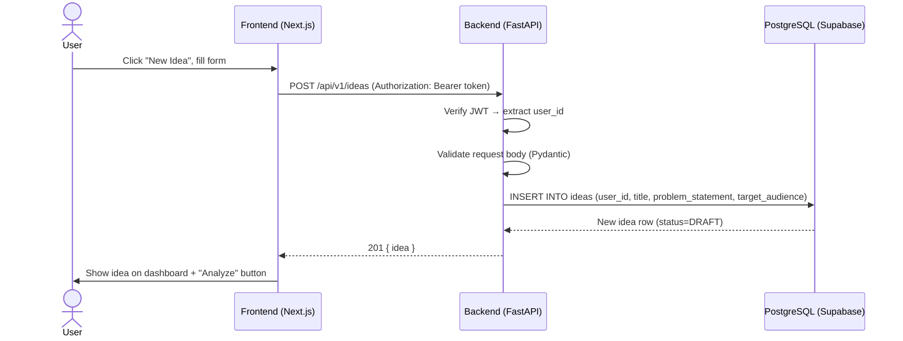
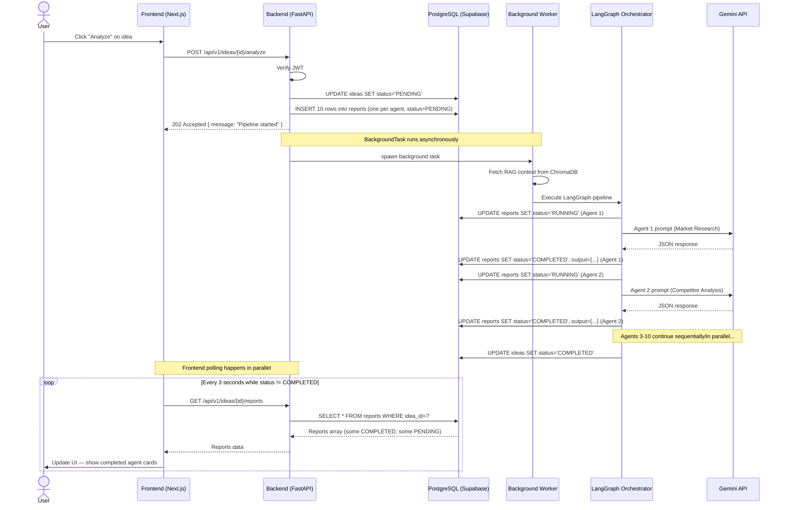
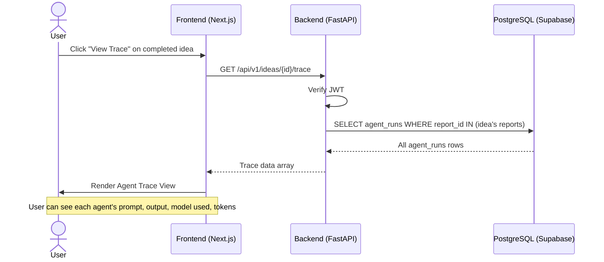
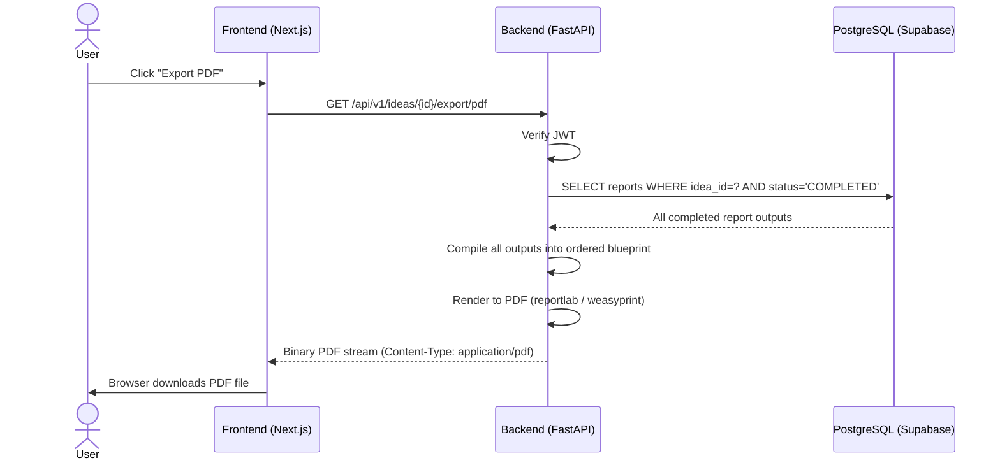
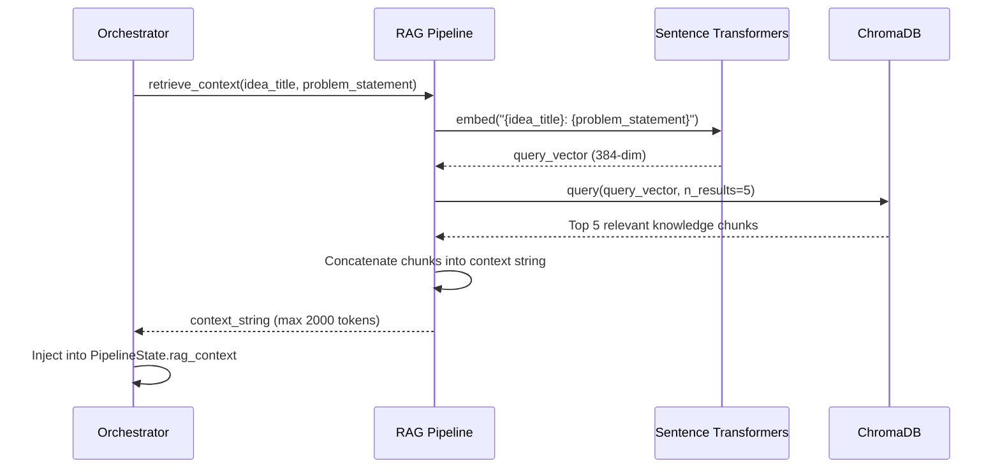
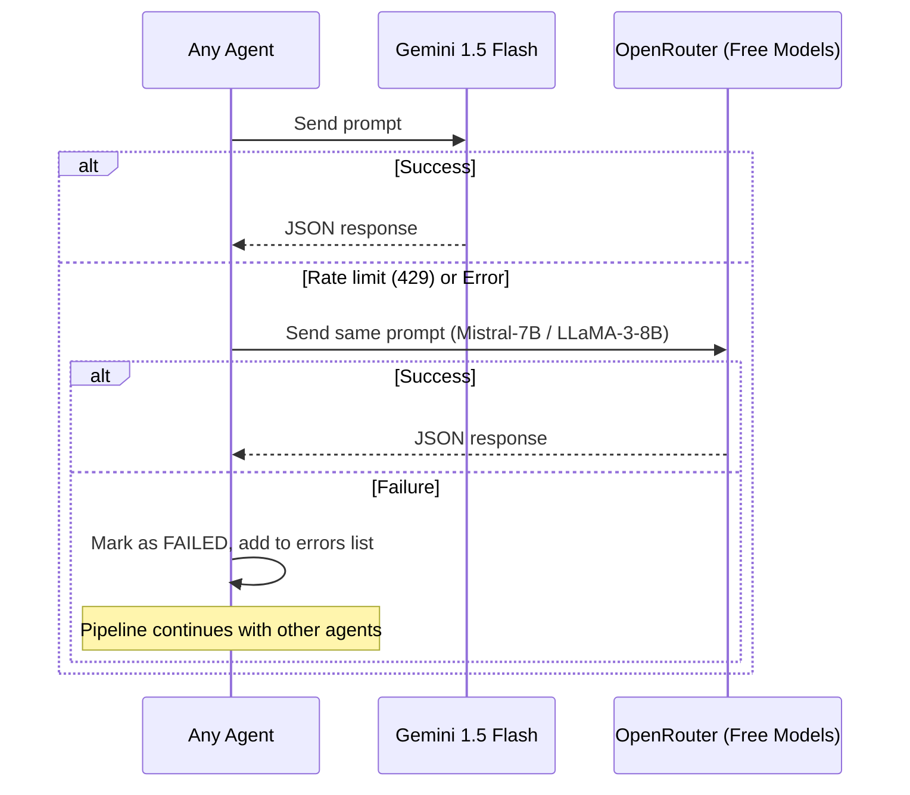

# FounderOS — Sequence Diagrams

**Version:** 1.0  
**Format:** Mermaid sequence diagram syntax (renders on GitHub, VS Code, Notion)

---

## 1. User Registration Flow

---

## 2. User Login Flow

---

## 3. Create Idea Flow

---

## 4. Trigger Analysis Pipeline Flow

---

## 5. View Agent Trace Flow

---

## 6. Export Blueprint Flow

---

## 7. RAG Context Retrieval Flow

---

## 8. LLM Fallback Flow

